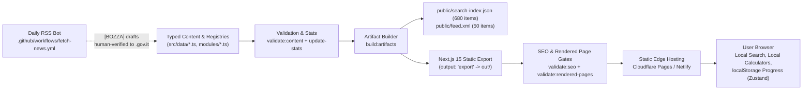

# Busssola

> *Guida civica gratuita, indipendente e open-source per orientarsi tra burocrazia, diritti, bonus, fisco e sicurezza digitale in Italia.*
> *(Free, independent, open-source civic guidance platform for navigating Italian public administration, rights, welfare benefits, taxes, and digital safety.)*

Live site: **[busssola.com](https://busssola.com)** · Source: **[github.com/ajdohaxhia/busssola](https://github.com/ajdohaxhia/busssola)**

---

## Table of Contents

- [What Busssola Is](#what-busssola-is)
- [Who Made It & Governance](#who-made-it--governance)
- [What It Contains](#what-it-contains)
- [How It Works (Architecture & Data Pipeline)](#how-it-works-architecture--data-pipeline)
- [Technology Stack](#technology-stack)
- [Repository Layout](#repository-layout)
- [Local Development & Verification Commands](#local-development--verification-commands)
- [Deployment](#deployment)
- [Accessibility & Privacy](#accessibility--privacy)
- [Contributing & License](#contributing--license)
- [Disclaimer](#disclaimer)

---

## What Busssola Is

**Busssola** ("from doubt to official procedure" — *Dal dubbio alla pratica ufficiale*) is a civic resource hub built to reduce informational anxiety and cognitive overload for citizens, families, students, workers, caregivers, and vulnerable people living in Italy.

Italian public procedures, tax obligations, welfare thresholds, and digital security alerts are often scattered across complex circulars, decree texts, and multiple portals (`INPS`, `Agenzia delle Entrate`, `AdER`, `ANPR`, `App IO`, ministries, and local municipalities). Busssola translates these rules into calm, structured, step-by-step operational guides backed by direct primary `.gov.it` and institutional citations.

### Core Principles

- **Source-verified only**: guides, deadlines, and civic news cite official authorities and track verification dates (`src/data/officialSources.ts` & `src/data/editorial/sourceOfTruth.ts`).
- **No hype, no clickbait, no paywalls**: plain Italian written to lower stress—especially on sensitive topics like scams, sextortion, stalking, domestic violence (`1522`), or tax collection notices.
- **Privacy by architecture**: no user accounts, no server-side database, no behavioral profiling, no advertising, and zero vendor lock-in.
- **Simplify, never replace**: Busssola clarifies what documents are required and which official `.gov.it` portal handles the procedure, rather than acting as an intermediary or legal/medical/financial advisor.

> **Why three `s`s in `Busssola`?**
> The domain `busssola.com` uses three `s`s purely because the standard two-`s` Italian spelling (*bussola*) was unavailable as a domain. It carries no symbolic meaning; inside prose, *bussola* (standard spelling) is used naturally while **Busssola** refers to the platform.

---

## Who Made It & Governance

Busssola was created and is maintained by **Adelajdo Haxhiaj** (Milan, Italy), with an open-source codebase open to community contributors on GitHub.

- **Creator profile**: [busssola.com/adelajdo-haxhiaj](https://busssola.com/adelajdo-haxhiaj/) (implemented in `src/app/adelajdo-haxhiaj/page.tsx`)
- **Contact**: [`info@busssola.com`](mailto:info@busssola.com)
- **Accessibility feedback**: [`accessibilita@busssola.com`](mailto:accessibilita@busssola.com)
- **Transparency & editorial standards**: published openly at `/trasparenza/` and `/metodo-editoriale/`, governed repository-wide by `AGENTS.md` and `CONTRIBUTING.md`.

There is no corporate sponsorship, affiliate monetization, or political affiliation behind the project.

---

## What It Contains

As of the **27 November 2026** update (`src/data/siteStats.ts`), the platform publishes:

| Content Type | Route | Current Scale | Purpose |
| :--- | :--- | :--- | :--- |
| **Thematic Modules & Lessons** | `/moduli/`, `/percorsi/` | **51 modules · 327 published lessons** across **19 categories** and **8 learning paths** | Step-by-step procedures for SPID, CIE, IT-Wallet, ANPR residency, NASpI, 730, ISEE, pensions, P.IVA, Lei 104, AIRE, digital safety, and consumer rights |
| **Document & Action Kits** | `/modelli/` | **53 kits** | Checklists of required documents, steps, and official portals (e.g. F24/IMU, Bonus Natale, `1522` & Reddito di Libertà, police fraud reporting) |
| **Civic Tips ("Trucchi Civici")** | `/tips/` | **109 tips** | Quick, practical shortcuts and error-prevention guides |
| **Verified Civic News & Alerts** | `/novita/`, `/feed.xml` | **107 news items** (**50** in RSS feed) | Institutional updates from INPS, Agenzia delle Entrate, AdER, CERT-AgID, Polizia Postale, Ministries, and ARERA |
| **Civic & Tax Deadlines** | `/scadenze/`, `/scadenze/2027/` | **15 deadlines** | Key tax, ISEE, pension, school enrollment, and Riscossione dates with "what happens if missed" guidance |
| **Checklists** | `/checklist/` | **1,199 checklist items** | Printable/trackable action steps embedded across lessons |
| **Primary Sources** | `/fonti/` | **431 citations** across **117 organizations** | Traceable `.gov.it` and institutional URLs |
| **SOS Center & Security Banner** | `/sos/`, `SecurityAlertBanner`, `SOSButton` | **17 emergency triage cases** | Immediate `112` priority banner, **1522** antiviolence phone/chat/shelter resources, and digital recovery protocols for scams, stalking, and account hijacking |
| **Local Calculators & Finders** | `/tool/` | **5 interactive tools** | Net salary from RAL, net 13th-month pay (*tredicesima*), ISEE bonus finder, official procedure finder, and household electricity cost estimator |
| **Comparisons & Annual Hubs** | `/confronti/`, `/guide/`, `/bonus-2027/`, `/isee-2027/`, `/pensioni-2027/`, `/ai/`, `/scuole/` | Dedicated hubs | Side-by-side comparisons (`SPID vs CIE vs IT-Wallet`, multi-channel scam recognition matrix, AdER installment rules), teacher lesson plans, AI literacy, glossary, and FAQ |

---

## How It Works (Architecture & Data Pipeline)

Busssola is designed as a **zero-backend, Content-as-Code static web application**. All content lives in typed TypeScript files in `src/data/`, is validated and compiled at build time into static HTML plus JSON/XML artifacts, and runs searches, calculators, and progress tracking entirely inside the user's browser.



### 1. Typed Content-as-Code Layer (`src/data/`)

Instead of a runtime CMS or SQL/NoSQL database, all site knowledge is modeled with strict TypeScript types (`src/types/`):

- **Official Source Registry (`src/data/officialSources.ts`)**: centralized dictionary of verified institutional portals (`OFFICIAL_SOURCES`) keyed by ID so guides, kits, and news share canonical `.gov.it` links.
- **Editorial Source-of-Truth Ledger (`src/data/editorial/sourceOfTruth.ts`)**: tracks major civic provisions with issuing authority, legislative act reference, `legalStatus` (`enacted`, `proposed`, `expired`, `temporary`), `reviewerStatus`, applicability year, and `lastVerifiedDate`.
- **Civic Modules (`src/data/modules/*.ts`)**: 51 modular files aggregated in `src/data/modules/index.ts`. Every lesson tracks prerequisites, steps, common mistakes, things not to do, checklists, FAQs, and `officialLinksV2` / `sources`.
- **Supplementary Datasets**: `news.ts`, `deadlines.ts`, `templates.ts`, `life-hacks.ts`, `sos-cases.ts`, `paths.ts`, and `tools/*.ts`.

### 2. Build-Time Validation, Stats & Artifact Generation (`scripts/` & `src/scripts/`)

Before Next.js builds or starts dev mode (`predev` / `prebuild`), Node scripts execute via `tsx`:

1. **`scripts/validate-content.ts` (`npm run validate:content`)**: validates module structure, unique slugs/IDs, required step/checklist fields, valid `sourceId` keys against `OFFICIAL_SOURCES`, and SEO metadata length limits (`title`, `summary`).
2. **`src/scripts/update-stats.ts` (`npm run update-stats`)**: computes live metrics across all published modules, lessons, tips, sources, and checklist items, writing `src/data/siteStats.ts` and `src/data/modules-meta.ts`.
3. **`scripts/build-site-artifacts.ts` (`npm run build:artifacts`)**: generates two static runtime artifacts inside `public/`:
   - `public/search-index.json` (~279 KB, 680 indexed entries spanning tools, guides, kits, tips, lessons, learning paths, news, and top-level sections).
   - `public/feed.xml` (RSS 2.0 feed of the 50 latest verified news entries).

### 3. Static Site Generation (`next.config.ts`)

Next.js runs with:
- `output: "export"` — pre-renders every module, lesson, kit, tip, news article, and hub page into pure static files in `out/`.
- `trailingSlash: true` — enforces canonical URL consistency across static hosts and SEO `rel="canonical"` tags (`withTrailingSlash` in `src/lib/seo-core.ts`).
- `images: { unoptimized: true }` — ensures zero server-side image-proxy dependency on static edge CDNs.

Every page includes structured Schema.org JSON-LD (`src/components/seo/JsonLd.tsx` and `src/lib/seo.ts`: `WebSite`, `Organization`, `Article`, `CollectionPage`, `FAQPage`, `BreadcrumbList`, `SoftwareApplication`, `ProfilePage`).

### 4. Client-Side Search, Tools & Local Storage (`src/lib/`, `src/store/`)

- **Browser Full-Site Search (`/cerca`, `src/lib/search.ts`)**: loads `public/search-index.json` client-side and runs a pure TypeScript search engine (`normalize` strips accents/diacritics with Unicode NFD normalization; `tokenize` filters Italian stopwords; `searchItems` scores multi-token coverage + exact/prefix/substring title, keyword, category, and summary matches + `TYPE_BOOST` weights by content type). Covered by Node's built-in test runner in `scripts/search.test.ts`.
- **Client-Side Calculators (`/tool/*`)**: salary, 13th-month pay, ISEE benefit matching, procedure lookup, and appliance kWh/euro estimation execute solely in browser memory—user inputs never leave the device.
- **Local Progress & Theme (`/profilo`, `src/store/useGameStore.ts`)**: Zustand `persist` middleware saves completed lessons, viewed modules, and dark/light theme preference inside `window.localStorage` (with an in-memory fallback for restricted private-browsing contexts), plus JSON backup export and import.

### 5. Automated News Discovery & Editorial Curation

- `.github/workflows/fetch-news.yml` runs daily at `07:00 UTC` via GitHub Actions and executes `scripts/fetch-news.ts --write` against curated Italian civic RSS queries (`TOPICS`).
- Newly fetched items are committed with `[BOZZA]` markers and `[skip ci]`.
- During routine editorial updates, `[BOZZA]` Google News RSS stubs are reviewed, verified against primary `.gov.it` / institutional bulletins (`INPS`, `Agenzia delle Entrate`, `AdER`, `CERT-AgID`, `Polizia Postale`, Ministries), rewritten with operational steps and primary links, and cross-linked into affected modules, kits, and deadlines.

### 6. Post-Build SEO & Rendered HTML Verification

- `npm run validate:seo` (`scripts/validate-seo.ts`) parses built HTML files under `./out/` to verify non-generic `<title>`, `<meta name="description">`, single `<h1>`, `https://busssola.com` canonical URLs, and Open Graph tags.
- `npm run validate:rendered-pages` (`scripts/validate-rendered-pages.ts`) verifies rendered static page content integrity before deployment.

---

## Technology Stack

Verified from `package.json`, `.node-version`, `next.config.ts`, `netlify.toml`, and `wrangler.toml`:

- **Runtime**: Node.js `20`
- **Framework**: Next.js `15.5.16` (App Router, Static Export)
- **UI**: React `19.2.3`, Tailwind CSS `v4` (`@tailwindcss/postcss`), `framer-motion`, `lucide-react`, `@radix-ui/react-slot`, `sonner`
- **Language & Validation**: TypeScript `^5` (`strict` mode), `zod`, `react-hook-form`
- **State & Visualization**: `zustand` (`localStorage` persistence), `recharts`, `react-markdown`, `canvas-confetti`
- **Tooling & Testing**: `eslint` `^9` (`eslint-config-next`), `tsx`, `node --test` (`scripts/search.test.ts`), `jsdom`
- **Hosting Targets**: Cloudflare Pages (`wrangler.toml`) and Netlify (`netlify.toml`) serving `out/`

---

## Repository Layout

```text
.
├── .github/workflows/
│   └── fetch-news.yml           # Daily 07:00 UTC RSS draft importer
├── scripts/
│   ├── build-site-artifacts.ts  # Generates public/search-index.json & public/feed.xml
│   ├── fetch-news.ts            # RSS news fetcher and topic-to-module mapper
│   ├── search.test.ts           # Unit tests for client-side search engine
│   ├── validate-content.ts      # Content, sourceId, and SEO schema validator
│   ├── validate-rendered-pages.ts
│   └── validate-seo.ts          # Validates exported HTML meta/canonical/H1 tags in out/
├── src/
│   ├── app/                     # Next.js App Router pages & static routes (30+ routes)
│   ├── components/              # Layout, UI primitives, SOS banners, SEO JsonLd, lesson views
│   ├── config/                  # Site stats consumer wrapper
│   ├── data/
│   │   ├── editorial/           # Editorial source-of-truth legislative ledger
│   │   ├── modules/             # 51 civic & digital-safety modules + metadata
│   │   ├── seo/                 # Search intent mapping
│   │   ├── tools/               # Static datasets for calculators & finders
│   │   ├── deadlines.ts         # Fiscal/welfare/school deadlines
│   │   ├── life-hacks.ts        # 109 civic tips
│   │   ├── news.ts              # Verified civic news bulletins
│   │   ├── officialSources.ts   # Central registry of 400+ institutional sources
│   │   ├── paths.ts             # 8 guided learning paths
│   │   ├── sos-cases.ts         # 17 physical/mixed/digital SOS triage protocols
│   │   └── templates.ts         # 53 document & procedure preparation kits
│   ├── lib/                     # Search engine, SEO builders, stats derivation, categories
│   ├── scripts/
│   │   └── update-stats.ts      # Regenerates siteStats.ts & modules-meta.ts
│   ├── store/
│   │   └── useGameStore.ts      # Local-only Zustand store (progress + dark/light theme)
│   └── types/                   # Shared TypeScript interfaces
├── AGENTS.md                    # Architectural, editorial, accessibility & SEO rules
├── CONTRIBUTING.md              # Content & technical contribution guidelines
├── netlify.toml                 # Netlify build, CSP & security headers config
├── wrangler.toml                # Cloudflare Pages build output config (`out/`)
└── package.json
```

---

## Local Development & Verification Commands

### Quick Start

```bash
git clone https://github.com/ajdohaxhia/busssola.git
cd busssola
npm install
npm run dev
```

`npm run dev` automatically runs `predev` (`npm run build:artifacts`) so `/cerca` and `/feed.xml` work immediately at `http://localhost:3000`.

### Available NPM Scripts (`package.json`)

| Script | Command | What It Does |
| :--- | :--- | :--- |
| `npm run dev` | `tsx scripts/build-site-artifacts.ts && next dev` | Builds search index & RSS feed, then starts Next.js dev server |
| `npm run validate:content` | `tsx scripts/validate-content.ts` | Validates all modules, paths, templates, news, and `OFFICIAL_SOURCES` IDs |
| `npm run update-stats` | `tsx src/scripts/update-stats.ts` | Regenerates `src/data/siteStats.ts` and `src/data/modules-meta.ts` |
| `npm run build:artifacts` | `tsx scripts/build-site-artifacts.ts` | Rebuilds `public/search-index.json` and `public/feed.xml` |
| `npm run typecheck` | `tsc --noEmit` | Runs strict TypeScript type checking |
| `npm run lint` | `next lint` | Runs ESLint across the codebase |
| `npm test` | `node --import tsx --test scripts/search.test.ts` | Runs search normalization, tokenization, and ranking unit tests |
| `npm run build` | `prebuild && next build` | Runs `validate:content`, `update-stats`, `build:artifacts`, and exports static site to `out/` |
| `npm run validate:seo` | `tsx scripts/validate-seo.ts` | Checks titles, descriptions, single `<h1>`, OG tags, and canonical URLs in `./out/` |
| `npm run validate:rendered-pages` | `tsx scripts/validate-rendered-pages.ts` | Verifies rendered HTML output of key static pages |
| `npm run fetch-news` | `tsx scripts/fetch-news.ts` | Previews RSS civic news candidates (append `--write` or use `fetch-news:write`) |

Full pre-release check sequence:

```bash
npm run typecheck && npm run lint && npm test && npm run build && npm run validate:seo && npm run validate:rendered-pages
```

---

## Deployment

Building with `npm run build` produces a self-contained static directory at `out/`.

- **Cloudflare Pages**: configured via `wrangler.toml` (`pages_build_output_dir = "out"`, `nodejs_compat`).
- **Netlify**: configured via `netlify.toml` (`command = "npm run build"`, `publish = "out"`, `NODE_VERSION = "20"`) with strict security headers (`X-Frame-Options`, `nosniff`, HSTS preload, `Permissions-Policy`, and Content Security Policy restricting scripts/connections to `'self'`).

---

## Accessibility & Privacy

- **Accessibility**: Designed around **WCAG 2.2 Level AA** practices (`AGENTS.md` & `/accessibilita/`), including semantic HTML landmarks, skip-to-content link, full keyboard navigation with visible high-contrast focus rings, responsive touch targets, `prefers-reduced-motion` awareness, and persisted Light/Dark themes.
- **Security Headers & Zero Telemetry**: Static export guarantees no session cookies or server logs of user calculations. CSP in `netlify.toml` locks `connect-src`, `frame-ancestors`, and `form-action` to `'self'`.

---

## Contributing & License

Contributions (new procedural guides, broken `.gov.it` URL fixes, deadline updates, life hacks, UI/accessibility improvements) are welcome—see [`CONTRIBUTING.md`](./CONTRIBUTING.md) and [`AGENTS.md`](./AGENTS.md) for editorial tone and mandatory primary-source citation rules.

Licensed under the **[MIT License](./LICENSE)** (Copyright © 2026 Adelajdo Haxhiaj / Busssola).

---

## Disclaimer

Busssola is an independent civic education and orientation project and **is not affiliated with the Italian Government, Public Administration, INPS, Agenzia delle Entrate, or law enforcement**. Its content is strictly informational and does not constitute legal, tax, financial, medical, or psychological advice. Only official institutional portals hold legal validity. In any physical emergency, immediate danger, or ongoing violence, contact **`112`** (or **`1522`** / [`1522.eu`](https://www.1522.eu/) for antiviolence and stalking support).
